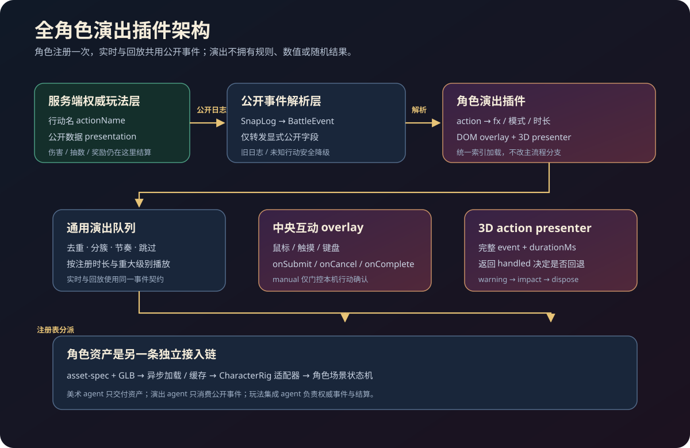

# 全角色演出工作流

> 适用范围：任意角色的视觉资产、骨骼动画、中央交互演出、2D/3D 技能特效与回放演出。
> 本工作流只定义演出与接入契约，不代替角色玩法、服务端结算或 Issue 负责人。



## 0. 核心原则

**角色是插件，不是主流程分支。** 新角色应通过注册表接入；不得在 `Game.tsx`、`scene.ts`、通用 overlay 或事件解析层堆具体角色名、技能名和道具名。

一次角色演出通常分成三个可独立交付的部分：

| 角色 | 输入 | 允许修改 | 必须输出 | 禁止修改 |
|---|---|---|---|---|
| 美术资产 agent | 视觉方向、资产规格、现有 `CharacterRig` | `artifacts/collab/<asset>/` | GLB、可复现源、预览、SHA-256、验证证据、`HANDOFF.md` | `client/`、`server/`、`shared/` |
| 演出 agent | 公开事件契约、注册表、场景生命周期 | `client/src/battle/`、`client/src/battle3d/`、对应测试与预览 | 角色插件、降级行为、测试与浏览器证据 | 角色规则、数值、服务端结算、其他角色未交接文件 |
| 玩法集成 agent | 已验收资产与演出、Issue 明确授权 | 共享角色定义、资产适配器、服务端事件 | 权威行动日志、规则测试、角色接入 | 覆盖其他 agent 的临时文件 |

依赖方向：

```text
服务端权威 action log
  -> BattleEvent（只保留公开演出字段）
  -> action-presentation registry
  -> DOM overlay registry / 3D action presenter registry
  -> 玩家可见演出

asset-spec.json + GLB
  -> async loader / cache
  -> CharacterRig adapter
  -> 现有角色场景状态机
```

- 美术 agent 不 import 游戏运行时；演出 agent 不直接 import `artifacts/` 下的模型或贴图。
- 演出只消费公开事件，不读取资产内部骨骼，不决定随机结果、伤害、奖励或角色注册。
- 角色 GLB 在异步加载适配完成前保留在 `artifacts/collab/`，不要直接塞进同步角色工厂。
- 运行时程序化道具由自己的特效模块生成，不等于角色 GLB。

## 1. 后续 Agent 调用模板

新 agent 的任务提示词必须包含以下内容；缺失时先澄清，不要猜测权限或玩法语义。

```text
你负责【美术资产 / 演出 / 玩法集成】之一。
目标角色：<charId / 视觉版本>
输入：<Issue、基线 commit、契约文件、已有证据>
只修改：<明确路径>；不得修改：<规则、注册表、其他 agent 文件>
接口：<action name / fx / CharacterRig / FxOverlayProps / ActionPresenterContext>
完成标准：<测试、浏览器输入、性能预算、资源释放>
交付：<分支、文件清单、验证结果、已知限制>
授权：<是否允许 commit / push / PR；默认不允许>
```

开始前阅读当前工作区的 `AGENTS.md`，检查 `git status`、worktree 和 Issue 归属。已有 Assignee 时只做明确协作子任务，不抢认领。主工作区存在冲突或陌生改动时另建隔离工作区，不用破坏性命令恢复环境。

## 2. 角色接入总览

以任意新角色 `<charId>`、技能 `<actionName>`、演出 `<fx>` 为例：

1. 定义资产规格与动画语义，交付可复现资产。
2. 注册角色视觉 rig，或由集成负责人接入异步 GLB 适配器。
3. 在角色插件中注册 action → fx 配置。
4. 按需注册中央 DOM overlay 和 3D presenter。
5. 服务端只发送公开结构化事件；客户端不推算结果。
6. 验证旧数据、未知 fx、重复事件、跳过、销毁与移动端输入。

角色插件示例：

```ts
// client/src/battle/<character>-presentation.ts
import { registerActionPresentation } from './action-presentation.js';

export const MY_SKILL_FX = 'myCharacterSkill';

registerActionPresentation('myCharacterSkill', {
  fx: MY_SKILL_FX,
  mode: 'automatic',
  durationMs: 1800,
  major: true,
});
```

需要玩家先完成互动再提交的行动使用 `mode: 'manual'`。手动 gate 只覆盖本机行动确认，不能让 AI 或远端玩家等待人工输入。

## 3. 通用演出注册表

| 层 | 文件 | 键 | 职责 |
|---|---|---|---|
| 行动配置 | `client/src/battle/action-presentation.ts` | 服务端 `data.actionName` / 旧日志 `data.fx` | fx 名、manual/automatic、时长、是否重大事件 |
| DOM 演出 | `client/src/battle/fx-overlays.tsx` + 角色 overlay | 结构化 `data.fx` | 2D/3D 共用中央 UI、手动输入、状态反馈 |
| 3D 演出 | `client/src/battle3d/action-presenters.ts` + 角色 presenter | 结构化 `data.fx` | 将公开事件转换为场景命令 |
| 角色视觉 | `client/src/battle3d/characters/index.ts` + 角色 rig | `charId` | 专属模型、材质、挂点和语义姿态 |
| 2D 插件入口 | `client/src/battle/presentation-plugins.ts` | 模块副作用 | 集中加载角色 overlay，不在 `Game.tsx` 写角色 import |
| 3D 插件入口 | `client/src/battle3d/presentation-plugins.ts` | 模块副作用 | 延迟加载角色 presenter，保持 2D 不下载 Three.js |

通用注册接口：

```ts
registerActionPresentation(actionName, {
  fx, mode: 'manual' | 'automatic', durationMs, major,
});
registerFxOverlay(fx, OverlayComponent);
registerActionPresenter(fx, ({ scene, event, durationMs }) => {
  // 使用 event 的公开字段调用场景能力
});
registerCharacterRig(charId, visualId, createRig);
```

约束：

- `action-presentation.ts` 只放通用注册表，不放任何具体角色的内置注册。
- 新角色的 overlay 与 presenter 分别加入 2D/3D 插件入口；`Game.tsx` 和 `Battle3D.tsx` 只加载入口，不感知角色名。
- 2D 与 3D 入口必须分开，避免 2D 对局提前下载 Three.js。
- 角色常量与内置注册放在自己的 `*-presentation.ts` 插件。
- `FxOverlayProps` 使用 `onSubmit`、`onCancel`、`onComplete`，不再使用某个角色的动作名。
- 3D presenter 接收完整 `event` 与 `durationMs`，不再依靠参数位置猜测房间或目标。
- presenter 只依赖 `ActionPresentationScene` 的核心能力；角色专属场景方法在该 presenter 内做可选能力检查。
- 未注册 overlay 不渲染；未注册 presenter 回退到 `scene.playAction()`；未知 action 保留日志 `fx`，两者都缺失时使用通用 `skill`。
- 新 action/fx 优先新增注册项，不修改共享 `CharActionDef`，也不把视觉字段塞进规则类型。

## 4. 公开事件契约

演出由服务端权威结构化日志驱动，不从 HP 差分、日志文本或 UI 动画推断结果。

```ts
{
  seq: number,
  type: 'action',
  data: {
    pid: string,
    actionName?: string,
    fx: string,
    label?: string,
    targetId?: string,
    room?: string,
    presentation?: Record<string, unknown>,
  },
}
```

- 新行动由服务端发送 `data.actionName`；解析层用角色注册表把它映射为视觉 `fx`，因此不需要扩展 `BattleFxKind` 规则枚举。旧日志没有 `actionName` 时继续使用 `data.fx`。
- `presentation` 是角色插件专用的**公开演出数据**命名空间。
- 只有明确放入 `presentation` 的字段会进入 `BattleEvent.presentation`、`FxView` 和 `FxOverlayView`。
- 私有判定历史、未公开目标、`pendingThrows` 等不得进入该命名空间。
- `presentation` 是未知数据边界；每个插件必须自行校验字段、长度、类型和范围。
- 缺失或非法插件数据必须安全降级，不能让旧日志导致页面崩溃。
- `room` 是视觉落点，`targetId` 是视觉目标；两者语义不同，不能互相替代。
- 实际伤害、治疗、淘汰和随机结果继续使用各自权威日志与共享类型。

## 5. 手动互动演出

`mode: 'manual'` 的行动由通用 `Game.tsx` gate 接管，角色只需实现 overlay：

```tsx
function MyInteractiveOverlay({ view, interactive, reducedMotion, onSubmit, onCancel, onComplete }: FxOverlayProps) {
  // 完成互动后调用 onSubmit；页面只负责提交既有 ActionRequest
}
```

完成标准：

- 支持鼠标与触摸拖动、点击、键盘 Enter/Space。
- 命中区域至少 44×44 CSS px，使用 Pointer Events 与 pointer capture。
- 完整处理 `pointerdown/move/up/cancel/lostpointercapture`、窗口 blur 和页面隐藏。
- 未达到阈值时回弹；取消不发送网络请求；提交中防止重复触发。
- 状态至少包含 idle、active、result；结果展示不得覆盖快照或生成伤害。
- reduced-motion 停止非必要运动，保留明确状态反馈。
- 完成、取消、跳过、卸载时清理 timer、监听器与 RAF。
- 服务端失败后允许重新操作，成功与失败都以服务端响应为准。

## 6. 角色资产与动画

### 视觉与坐标契约

- 单位米，`+Y` 向上，`+Z` 向前，脚底 `y=0`，pivot 在脚底中心，无根运动。
- 先记录角色高度、朝向、挂点、材质角色和性能预算，再开始建模。
- 纹理内嵌，运行时不需要外部贴图请求。
- 角色 GLB 建议小于 4MB、最多约 65,000 三角面；超预算时明确取舍，不牺牲骨骼链与接触精度。
- 程序化一次性道具单独记录 mesh、三角面、draw call、geometry、material 与 texture 预算。

### 资产来源

- 明确使用程序化资产时无需探测外部凭据。
- 需要外部生成时先按已加载的 `threejs-game-director` skill 运行凭据探测，只输出 SET/MISSING，不打印密钥。
- 有凭据时先生成并检查代表角色，再绑定与动画；超时先检查任务回执和产物。
- 无凭据时使用项目内程序化源，并明确资产风格，不声称影视级写实扫描质量。

### `CharacterRig` 接入

现有角色视觉统一通过 `registerCharacterRig(charId, visualId, createRig)` 注册。未注册角色会自动回退 legacy Humanoid。

GLB 动画映射到语义姿态，不让场景知道具体 clip 名：

| 语义 | `CharacterRig` 方法 | 用途 |
|---|---|---|
| 待机 | `idle(time, phase)` | 常态呼吸与重心 |
| 移动 | `walk(time, intensity)` | 行走循环 |
| 攻击 | `attackSwing(progress)` | 挥击、拉杆、射击等单次主动作 |
| 受击 | `flinch(progress)` | 受击后仰 |
| 施法 | `cast(time)` | 持续举手姿态 |
| 使用道具 | `drink(time)` | 举杯、喝药等双手动作 |
| 躲藏 | `crouch(time)` | 下蹲 |
| 胜利 | `cheer(time)` | 终局欢呼 |
| 倒地 | `dead(progress)` | 淘汰倒地 |
| 复活 | `reviveRise(progress)` | 起身 |

接入规则：

1. `GLTFLoader.loadAsync()` 是异步的，现有 `createCharacterAsset()` 是同步工厂；必须先预加载并缓存，再由集成负责人实现适配器。
2. 适配器实现完整 `CharacterRig`，包括 `materials()`、`setOpacity()`、`headHeight()`、`resetPose()` 和全部姿态方法。
3. 场景每帧调用姿态方法，不会自动调用 mixer update；适配器在方法内设置 action 时间、采样并暂停 action。
4. 单次动画 progress 使用 `t∈[0,1]`；循环动画使用场景时钟。动画节奏与服务端结算时序分开设计。
5. 没有专项动画时显式降级到安全语义姿态，不保留空实现。
6. 多实例使用 `SkeletonUtils.clone()`；释放时解绑 action，并释放 geometry、material 及其引用 texture。
7. 需要新的通用姿态类别时，先扩展 `CharacterRig` 与场景公开能力，并给所有角色安全默认实现；不要只在某个角色分支里增加不可复用的方法。

## 7. 3D presenter 与场景生命周期

Presenter 使用公开事件上下文。返回 `true` 表示已处理；字段缺失、目标不存在或场景缺少能力时返回 `false`，由 `map-playback.ts` 回退到 `scene.playAction()`：
```ts
registerActionPresenter(MY_SKILL_FX, ({ scene, event, durationMs }) => {
  const capableScene = scene as ActionPresentationScene & {
    playMyEffect?(pid: string, room: string, seconds: number): void;
  };
  if (!event.pid || !event.room || !capableScene.playMyEffect) return false;
  capableScene.playMyEffect(event.pid, event.room, Math.max(0.8, durationMs / 1000));
  return true;
  return true;
});
```

一次性特效生命周期：

1. warning：目标预警。
2. active：运动或持续演出。
3. impact / result：命中或结果反馈。
4. settled：短暂停留、淡出。
5. dispose：移除节点，释放 geometry、material、texture。

要求：

- 随机碎屑使用可复现 seed，禁止 `Math.random()`；同 seed 与 duration 产生相同状态序列。
- reduced-motion 直接呈现结果，不坠落、不旋转、不出碎屑或闪光。
- low-effects 去掉高成本碎屑、额外灯光与镜头抖动，保留清晰反馈。
- 使用现有 `FxInstance`、`spawnFx()`、`resetPresentation()` 和 `dispose()`，不自建无法清理的 RAF/timer。
- 镜头聚焦和震动尊重 reduced-motion 与 low-effects。
- 目标不存在时安全忽略，不制造新的房间或规则状态。

### 回放接入

- `ReplayFrame.logs` 保留服务端公开 `data`，包括 `actionName`、`fx` 与 `presentation`；旧回放没有这些字段时安全降级。
- 将角色演出接入回放时，应让回放消费同一 `BattleEvent` 与 `playMapEvent()`，不通过日志文本重建演出。
- manual 行动在回放接入后按 automatic 非交互播放，不等待玩家重新拉杆或点击；回放不得再次提交 `ActionRequest`。
- 回放录制只保存权威公开日志，不保存未公开目标、判定历史或内部钩子。
- 当前 `ReplayViewer` 仍以状态帧和日志展示为主；本次提供公开 `data` 与事件解析契约，不宣称已接入完整 3D 演出。

## 8. 验证清单

### 单元与组件测试

```bash
npm install
npx vitest run tests/ui/<character>-presentation.test.ts
npx vitest run tests/ui/<character>-overlay.test.tsx
npx vitest run tests/ui/<character>-fx.test.ts
npm run typecheck:client
npm test
npm run build
```

新角色至少覆盖：

- action/fx 注册、`actionName` 映射、时长、重大事件标记与未知 fx 降级。
- 2D/3D 统一插件入口加载角色，且 2D 不提前下载 Three.js。
- presenter 返回 false 时回退 `scene.playAction()`。
- 回放帧保留公开 `data`，可据此解析角色演出，无需实时输入。
- 任意新角色 overlay 能通过注册表渲染并接收公开 `presentation` 数据。
- 私有日志字段不会进入公开演出视图。
- 手动点击、拖动、短拖动回弹、pointer cancel、blur、键盘、取消不提交。
- 服务端失败后允许重试，提交中不重复发送。
- presenter 使用事件房间而非目标 ID；未知 presenter 回退原 `playAction()`。
- 动画 progress、接触时点、脚底贴地、资源释放。
- 相同 seed 的确定性、reduced-motion、low-effects、dispose 资源释放。
- 地图 playback 优先调用 presenter，未来回放接线复用该入口时不依赖实时输入。

### 浏览器验证

使用生产组件建立独立预览入口，不能用示意图代替。桌面与 390px 移动端均需检查：

- 中央演出不遮挡关键操作，无横向溢出，触摸目标足够大。
- 实际 pointer 拖动、点击、键盘、取消、窗口失焦与 visibility 清理。
- 2D/3D 完整时序；reduced-motion 立即呈现结果。
- console/page/network 错误为零。
- 记录 renderer calls、triangles、geometry、texture，并验证重复播放后回到基线。
- 保存关键帧、短动作序列、验证 JSON 和缺陷记录；截图不能替代输入与状态测试。

## 9. 交接与 PR

交付时明确列出：

- 工作区、分支、基线、修改文件与未修改的规则模块。
- GLB 路径、SHA-256、动画映射、预算与已知限制。
- 哪个 action name/fx 触发哪层演出，服务端需发出的公开字段。
- 角色专属场景能力及缺失时的降级行为。
- 运行过的命令、测试数量、浏览器输入、截图与性能数据。
- 尚未完成项，以及玩法负责人需要决定的结算时机与语义。
- 默认未提交、未推送，除非用户明确授权。

资产与演出建议拆成独立 PR；两者验收后再由玩法负责人接入异步资产缓存、角色适配器和权威事件。协作 PR 使用 `Refs #<Issue>`，不代替 Assignee 关闭 Issue。

## 10. 完整示例：老虎机侠

老虎机侠是本工作流的一个角色插件，不是通用接口本身。

- 角色插件：`client/src/battle/slot-machine-presentation.ts`。
- 中央 overlay：`client/src/battle/slot-machine-overlay.tsx`。
- 数字映射：`client/src/battle/slot-machine-reels.ts`。
- SVG 图标：`client/src/battle/slot-symbol-icon.tsx`。
- 3D 掉落 presenter：`client/src/battle3d/slot-drop-presenter.ts`。
- 运行时 3D 道具：`client/src/battle3d/slot-drop-fx.ts`。
- 角色资产交接：`artifacts/collab/slot-hero/HANDOFF.md`。

卷轴公开数据支持三位或四位数字；有 `reels` 时以其长度和数字为准，没有权威数字时才读取 `reelCount` 生成确定性预览。三位预览对应 1 金钱抽数、四位预览对应 5 金钱抽数；这些价格只是视觉模式说明，扣费、抽数和投掷伤害均由玩法负责人结算。投掷机落地后继续显示同一公开卷轴数据。

```ts
// 三位模式预览（实际抽数由玩法负责人决定）
{ pid: 'A', fx: 'slotPull', presentation: { reelCount: 3 } }

// 四位权威结果；中央拉杆与落地演出共用
{ pid: 'A', fx: 'slotDrop', presentation: { reels: [0, 3, 8, 9] } }
```

映射为 `0 钥匙、1–3 金钱、4–7 炸弹、8–9 攻击`。数字只承担演出；四连奖励、抽卡价格、改符号、伤害与角色规则仍归玩法负责人。

后续新增角色时复制的是**分层与注册方式**，不是复制老虎机的数字、符号、拉杆或道具实现。
