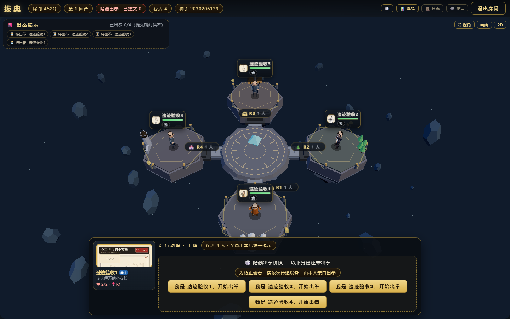

# 悬浮遗迹竞技场

悬浮遗迹沿用拔典的六棱石台和房间图腾。青灰岩层托起独立战台，金属嵌线和分段石桥引向中央仪式台。冷色环境光勾勒边缘，暖色主光照亮角色与踏面。房间主题色约束在地面和低矮图腾。灯柱和远景碎岩避开角色的主要交战空间。场景使用仓库内程序化几何、图腾和原有角色资产。

MAP-101 石材细化（2026-11-22）：岩层升级为五层锥度 + 凿刻基座圈梁 + 层缝碎岩，岩面与桥面用顶点色烘焙遮蔽和面级杂色模拟凿刻纹理（零纹理开销）；中央仪式台外环新增 8 根断柱残柱环阵、倒伏残柱与台缘碎砾，岛底悬挂遗物青晶簇，遗物伴生小浮岩随遗物浮动；石桥加断续护栏；背景由平色改为三段式渐变天穹，衔接雾色。所有装饰均低于角色站立面与步行弧线，绘制调用 +20（169 → 189），见 `screenshots-map101/` 前后取证。

## 云海、集雨和导流

岛底有流云，天候按云海初霁、穿岛阵风、斜风骤雨、雨后薄雾循环。风吹动云和气流，雨线斜穿岛间，薄雾留在远景。精简特效和减少动态效果保留天气色调、房间警示及陷阱标记。地图使用回合边界推进天气，独立种子流驱动天气时长和泥潭位置。

骤雨有机会令一间房积水。水渠和房间标记会提前一回合预警，积水房内取得行动资格的玩家可消耗一次行动开启泄水闸。若无人开启，泥潭在下一回合封闭该房的移动入口，回合结束后退去。玩家仍可从泥潭房撤离，攻击、投掷和其他行动按既有规则结算。试图移入会被拒绝，并可重新选择行动。房间选择和地图播报在 3D 与 2D 共用服务端状态。

## 玩家看到的状态

| 状态 | 表现 |
| --- | --- |
| 正常与空房 | 低亮铜色边线，空房名牌降低亮度并标人数 |
| 行动中 | 角色脚下金环，房间灯和标签显示行动状态 |
| 可选与已选 | 绿色表示可选，青色边框确认当前选择 |
| 范围预警与受击 | 预警先亮出相关石台，随后出现范围波纹、命中和逐对象反馈 |
| 回复 | 薄荷色房间边线和角色回复反馈 |
| 待爆与爆炸 | 橙色持续标识和最早爆炸回合，结算时先呈现冲击，后呈现逐角色伤害 |
| 终局 | 胜者以金色状态和较近机位呈现，平局保持全场取景 |

角色名牌、HP、行动状态与危险提示保留在屏幕空间。MAP-102（2026-11-22）：名牌按房间分批——少数各自锚定头顶，5 人以上收拢为向上生长的名册并自动压缩，已淘汰成员压缩灰章始终可见；近侧房间标签移到平台下方门牌位；待爆房间标签实底橙 + 独立警示行，标签置顶保证密集时可读。3D 房间可以用石台或标签选择。标签支持键盘确认。拖动旋转、滚轮缩放，按「视角」恢复全局。在「画面」中可停用自动镜头或开启精简特效。2D 开关继续可用。

| 演示 | 实际画面 |
| --- | --- |
| 空房与同房 | [三人同房，其他房间仍在原位](screenshots-v5-map/03-same-room.png) |
| 窄屏布局 | [390 × 844 竖屏对局](screenshots-v5-map/04-portrait.png) |
| 延迟危险 | [待爆房间](screenshots-v5-map/02-pending.png) |
| 范围与结算 | [伍六七范围预警](screenshots-v5-map/05-aoe.png) · [爆炸冲击](screenshots-v5-map/06-blast.png) |
| 胜负反馈 | [胜者镜头](screenshots-v5-map/08-winner.png) · [胜负弹层](screenshots-v5-map/07-result.png) |
