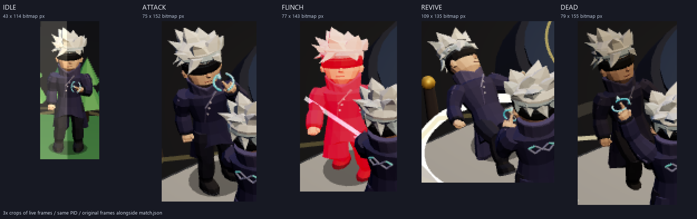

# V5.0-B · 五条悟实战验收

## 1. 玩家可见变化

五条悟在 3D 对局中使用自己的模型。银白尖发与环绕眼罩区分头部，高领、分叉衣摆和靴子构成深靛色剪影。待机时转头呼吸，出手时扭身伸手，青色指印放大，受击时收肩屈膝。余命触发时起身，最终淘汰后倒地淡出。

## 2. 为什么选五条悟

选角时在仓库内未找到 V5.0-A。后续工程化工作查阅了仓库外的 `BA-DIAN-V5.0-A-audit.md`：审计推荐 `ivan-girl` 的 GLB 试点，五条悟是实际 B 阶段采用的程序化方案，并非审计推荐。现有 `client/public/cards/gojo.webp` 和缩略图提供视觉参照。白发与深衣可从俯视角形成明暗对比，两条命允许在同一角色、同一局中分别验证受击、余命和最终淘汰。

## 3. 资产来源与格式

项目内手工编写 Three.js 几何，运行时创建 `BufferGeometry`、顶点色和 `MeshStandardMaterial`。角色朝 +Z，脚底以 y=0 为基准。以头、躯干、衣摆和四肢的局部关节驱动程序化动作。未下载外部模型、贴图或动画，也没有新增模型加载依赖。现有角色卡继续用于 UI。

## 4. 资产与事件接口

`createCharacterAsset(charId)` 返回资产 ID、rig、可选道具及幂等的 `dispose()`。注册表将 `gojo` 映射到 `gojo-v1`，其他角色继续走 `Humanoid`。服务器快照同步实体、生命和房间。事件队列和 `map-playback` 把表现命令交给场景。场景控制机位、根节点、受击停顿和进度，rig 只操作本地关节。相同 PID 与角色 ID 复用实例，换房更新父节点，换角或离场释放原资产。

五条悟有余命时，引擎恢复 HP 并发出带 `livesLeft` 的 `trigger`。最后一条命耗尽时，引擎设置 `alive=false` 并发出 `eliminate`。画面分别对应这两条路径。

## 5. 工作区文件及用途

| 文件 | 用途 |
|---|---|
| `client/src/battle3d/characters/gojo.ts` | 五条悟模型、材质、关节与动作 |
| `client/src/battle3d/characters/index.ts` | 资产接口、注册、通用人形回退与资源释放 |
| `client/src/battle3d/rig.ts` | 通用人形适配 `dead` 与行动者示意接口 |
| `client/src/battle3d/battle3d.css` | 仅在 3D 竖屏把行动坞排在战场下方，限制高度并允许滚动 |
| `client/src/battle3d/scene.ts` | 实体创建和复用、姿态优先级、材质恢复、倒地淡出、只读取证 |
| `tests/ui/gojo-asset.test.ts` | 比较不同姿态的网格变换和实例隔离，核对旧角色道具与缩放 |
| `tests/ui/gojo-lifecycle.test.ts` | 快照驱动和事件驱动的动作、离场与重入、换角换房、Three.js 释放事件 |
| `scripts/v50b-match.ts` | 通过实际 UI 进行三席对局，读取服务端广播、按 PID 记录渲染帧 |
| `docs/screenshots-v50b/` | 逐次运行的真实截图、结果和事件日志 |
| `docs/V5.0-B.md`、`TASKS.md` | 验收报告与项目任务索引 |

现有 B-031 的 WebGL 懒探测属于之前版本，未计入本轮改动。

## 6. 五行动作矩阵

以下五帧来自最终构建房间 `L8VS` 第一局，同一玩家 `P2-eags`。快照给出房间和生命值，`match.json` 另存每回合的服务器日志序号。读帧脚本只在目标 PID、资产和姿态均吻合时复制当前画布。

| 动作 | 触发与玩家所见 | 实战证据 |
|---|---|---|
| 待机 | 开局入场后转头、呼吸，衣摆轻摆 | 第 1 回合 R2，等待推镜停止，`01-idle.png` |
| 出手 | 近战宣告触发扭身、前伸指印 | 第 4 回合 P2 攻击 P3，服务端结算 P3 淘汰，`05-attack.png` |
| 受击 | 伤害触发收肩、屈膝和材质闪色 | 第 3 回合 P3 攻击 P2，P2 从 3 HP 降到 2，`04-hit.png` |
| 淘汰 | 最后一命耗尽后倒地，随后淡出并隐藏 | 第 6 回合 P1 攻击 P2，`eliminate` 和 `alive=false`，`07-death.png`。结算后探针确认 P2 隐藏 |
| 复活 | 余命生效，角色自低位撑起并恢复待机 | 第 5 回合 P1 攻击 P2，`trigger.livesLeft=1`，HP 恢复到 3，`alive=true`，`06-revive.png` |

## 7. 实战条件与连续对局

Windows 桌面 Chromium，隔离的本地客户端与 Socket.IO 服务端。最终房间 `L8VS`（两局种子 `3449104997`、`3442331977`，Chromium 159.0.8154.6）从游戏界面建房、出拳、选择行动与目标、确认、结算并重开。两名五条悟、一名通用人形，三席由同一台设备操作。部分名牌和房间标签由脚本调用 `HTMLElement.click()`，不构成逐步真实指针或触控验证。第一局 3D 六回合，验证分房、两次移动、三人同房和五个动作。重开时比较场景对象身份、三名玩家的 PID/房间/资产，以及几何和纹理计数。第二局切至 2D，再打六回合到胜负。两局权威日志和十二次行动均有记录。窄屏样本为桌面浏览器 390×844 CSS 像素，桌面为 1440×900。

运行次数：1 次手动（`RSEB`，完成换房，未结算），4 次脚本（归档按时间命名）。`14-29` 首局选目标超时；`14-34` 首局已结算，第二局重开后截图超时；`14-37` 修前连续两局结算；`14-47` 最终构建连续两局结算。合计有权威结算记录的完整对局为 **5 局**，其中 **2 局为最终构建**。最终房间无页面异常。结算时两具模型隐藏；同房重开复用原场景，几何 110 → 110、纹理 1 → 1，FX、行走和补间归零。

## 8. 性能与复用

单角色基准在 Windows x64、i7-14650HX、Node 24.22.1、Three r187 上独立执行。两种角色交替测七轮，取每轮单次平均主线程 CPU 时间的中位数。

| 单角色指标 | 五条悟 | 通用人形 `default` |
|---|---:|---:|
| 构造 | 3.87 ms | 0.712 ms |
| 待机 / 攻击姿态更新 | 2.37 / 2.16 µs | 0.562 / 0.312 µs |
| 待机 / 攻击含世界矩阵更新 | 3.32 / 3.71 µs | 2.44 / 2.06 µs |
| 网格 / 三角面 / 独立材质 | 13 / 3,894 / 2 | 14 / 800 / 5 |
| 几何属性及索引数组 | 410.7 KiB | 27.4 KiB |

构造预热 100 次，各轮 768 次。姿态预热 1 万次，各轮 50 万次，含矩阵的测量每轮 16 万次。构造计时排除释放。换房和复活保留原实例，待机切出手时 13 份几何全部复用。两名五条悟各自持有几何和材质，受击闪色、透明度和释放互不影响。手动房 `RSEB` 三名五条悟同场，待机单帧整场 140 次绘制、20,134 个三角面、109 份几何和 1 份纹理。单帧统计和 Node CPU 基准不能换算为手机帧率。

## 9. 实际截图

[桌面三人同房全景](screenshots-v50b/2026-11-21T14-47-11-623Z/03-same-room-full.png) · [3D 结算](screenshots-v50b/2026-11-21T14-47-11-623Z/08-finale.png) · [重开](screenshots-v50b/2026-11-21T14-47-11-623Z/09-reused-scene.png) · [2D 结算](screenshots-v50b/2026-11-21T14-47-11-623Z/11-2d-finale.png) · [两局逐回合记录](screenshots-v50b/2026-11-21T14-47-11-623Z/match.json)

每个动作各自保留原始 PNG，图版只裁切并作相同倍率的最近邻放大。原帧为 WebGL 画布，带 UI 的整页截图另存。`overlaps` 以同帧 DOM 矩形与角色投影包围框的交集计算，数值包含标签的透明区域。

## 10. 测试与构建

生命周期复核中重现了两种迟到事件。已经倒地的角色接到移动命令会错过淡出时间，离场后的受击和闪避补间仍会写入旧实例。分别修正了死亡/起身的姿态优先级和实体移除时的补间清理。两条针对性测试在修复前失败，修复后三组聚焦用例 54/54 通过。

最终源码在 `.tmp-build/v50b-final/work` 通过客户端和服务端 TypeScript 检查及独立构建。完整 `npm test` 为 **23 个文件、311/311 条通过**，0 失败、0 跳过，45.65 秒；含 Chromium E2E 5 条。本轮增加 21 条资产测试和 6 条生命周期测试；原有 284 条保留。最终另跑的两场截图实战不计入此数。

主 JS 从 973.10 kB 增至 985.55 kB（+12.45 kB），gzip 从 278.47 增至 283.60 kB（+5.13 kB）；CSS 从 100.33 增至 100.69 kB。隔离客户端含静态资源共 25 文件、1,533,895 字节；服务端含 source map 共 28 文件、497,532 字节。工作区既有 `client/dist`、`client/dist-e2e`、`server/dist` 共 78 文件，哈希和修改时间与开工记录一致。未提交、推送、修改生产配置或部署。

## 11. 未解决问题与审查边界

修前 [手机同房截图](screenshots-v50b/2026-11-21T14-37-32-245Z/03-mobile-viewport.png) 中行动坞覆盖角色整个投影框。修后 [同尺寸手机截图](screenshots-v50b/2026-11-21T14-47-11-623Z/03-mobile-viewport.png) 中角色约 36×86 位图像素，完整入镜，行动坞交集为零。名牌与角色框仍有约 8% 交集，揭示栏约 13%；桌面出手时其他名牌最大单项约 20%，稳镜待机时房间标签约 22%。这些是投影矩形比例，不是精确遮挡像素率。此次手机复测限于三席三房，未专项复测五、六房的触屏点选。

同设备多人下，界面按首席身份过滤可选目标，行动者可能是另一席。首轮自动取证因此在第 3 回合选择 P1 时中止。后续采用相同三席阵容，用 P2 作为固定观察对象，完成两局合法行动。此问题涉及公共选人界面，保留在本报告供后续单独处理。

当前会话的图像输入未显示 PNG。已核对原始像素尺寸、网格边界、角色姿态、UI 矩形及代表帧；正常观看距离能否一眼认出眼罩和指印，仍需直接看原图判断。缺少手机真机、移动 GPU 帧时间和长时间热稳定性数据。

## 12. Character Development Pipeline V1.0

[流程入口](../plugins/character-pipeline/README.md)包含九步工作流、资产/集成/动画/事件/测试/视觉规范、Agent 十步协议、四个模板，以及[五条悟 QA 示例](../plugins/character-pipeline/examples/first-character/character-qa.md)。规范区分源码契约、运行证据与人工验收，不把其他角色或外部资产纳入本轮范围。

## 13. 工程化阶段复核

从当前源码（含未提交项）建立独立副本 `.tmp-build/pipeline-full.yvFeoh/work`，分别运行双端 `tsc --noEmit`、`npm run build` 和 `npm test`。23 个文件、311/311 条通过，0 失败/跳过，Vitest 53.01 秒，包含 5 条通用 Chromium E2E。原 78 个产物文件的清单、SHA-256 和修改时间一致。复跑日志在本地 `.tmp-build/pipeline-full.yvFeoh/verification.log`；这次不新增五条悟定向对局。

[独立交接验证](../plugins/character-pipeline/examples/first-character/handoff-validation.md)是另一项交付。首轮 Agent 实跑专项 27/27 并发现命令授权与图像证据分级不够明确；修订规范和任务书后，另一 Agent 从新副本复跑也通过 27/27，并完成归档核证。验证范围限于现成五条悟的专项交接，不包括独立从零开发、GLB 或人工画面验收。

## 14. 下一阶段建议

先让观察者在桌面和一台实际手机上隐藏名牌辨认五条悟，并区分普通受击、消耗余命与最终淘汰。保留默认镜头原帧、触控反馈和活跃帧时，再决定是否单独修正剪影、手势或界面遮挡。本轮不启动 V5.0-C。
